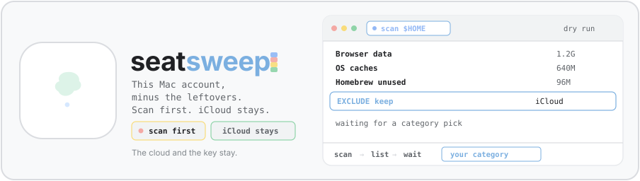
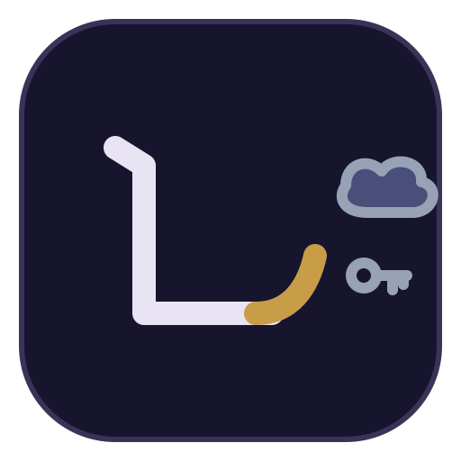

<p align="center">
  
</p>

#  seatsweep

*A dustpan with a keep list.*

I make this macOS account feel new. I do not erase the Mac. I do not delete the user. I do not sign out of iCloud. I scan, I list sizes, and I wait. I delete only the categories you name.

## Install

```bash
npx skills@latest add pahlevikun/seatsweep-macos-cleanup
```

## How a run goes

Confirm the keep list before the scan. iCloud, the macOS user, OS setup, folder layout, the terminal, and the agent tools stay. The full list is in [references/keep-policy.md](references/keep-policy.md).

Scan from the skill directory. The paths below are samples. Use `$HOME` on your machine, or `/Users/example` when you write the steps down for someone else.

```bash
python3 scripts/scan.py --home "$HOME" --output /tmp/account-cleanup.json
python3 scripts/report.py /tmp/account-cleanup.json --output /tmp/account-cleanup-report.html
```

The HTML report is category totals plus a path list. A rollup is not a delete list. Rows marked `EXCLUDE:keep` and `EXCLUDE:admin` stay out of the reclaimable number.

Pick categories by name. I dry-run that set and stop.

```bash
python3 scripts/cleanup.py /tmp/account-cleanup.json \
  --only-category "Browser local data" \
  --paths-file /tmp/account-cleanup-paths.txt
```

Read the path file. When you want the delete, say yes and rerun the same command with `--confirm`.

Admin paths need a macOS password dialog. I do not hang on `sudo` when there is no terminal. If you pick CoreSimulator, I unmount its disks first, then remove that tree. Command Line Tools stay.

After the delete I check the kept tools still run.

```bash
python3 --version
go version
elixir --version
rustc --version
git --version
```

I also check that the iCloud folders are still on disk. If a kept CLI breaks, I say so and I write the trap into [references/safety-notes.md](references/safety-notes.md).

## What I will not do

I will not factory reset the Mac. I will not delete the macOS user. I will not sign out of iCloud. I will not delete Documents, Desktop, or Pictures to make the account look new. I will not run `brew` as root.
